# Linux Server Infrastructure — Samba AD DC, DNS, Kea DHCP & Troubleshooting

## Project Overview

This project documents my hands-on experience building and troubleshooting a Linux-based server infrastructure in a virtual lab.

My goal was to gain practical experience with Linux server administration, network services, user management, authentication, monitoring, and troubleshooting.

Rather than focusing only on getting services running, I documented the problems I encountered, how I investigated them, and what I learned along the way.

The lab uses Ubuntu Server and Ubuntu clients. I configured a Samba Active Directory Domain Controller, tested Kerberos authentication, investigated DNS and DHCP issues, created Bash monitoring scripts, and performed controlled Fail2ban tests.

This is a personal learning project, not a production-ready infrastructure.

## Technologies Used

| Area | Technologies |
|---|---|
| Operating Systems | Ubuntu Server 24.04, Ubuntu Linux clients |
| Virtualization | Hyper-V, QEMU, libvirt |
| Directory Services | Samba Active Directory Domain Controller |
| Authentication | Kerberos, Samba, Winbind |
| DNS | Samba Internal DNS |
| DHCP | Kea DHCP |
| Monitoring | Bash, Cron, Linux logs |
| Security Testing | Fail2ban, SSH |
| Service Management | systemd |
| Networking | libvirt NAT, isolated lab network |

## Lab Architecture

The lab was built on a Windows machine running Hyper-V. Inside an Ubuntu Server virtual machine, I used QEMU/libvirt to create additional Linux VMs.

The Windows host was only used as the virtualization platform. All domain services, client tests, and troubleshooting exercises were performed on Linux systems.

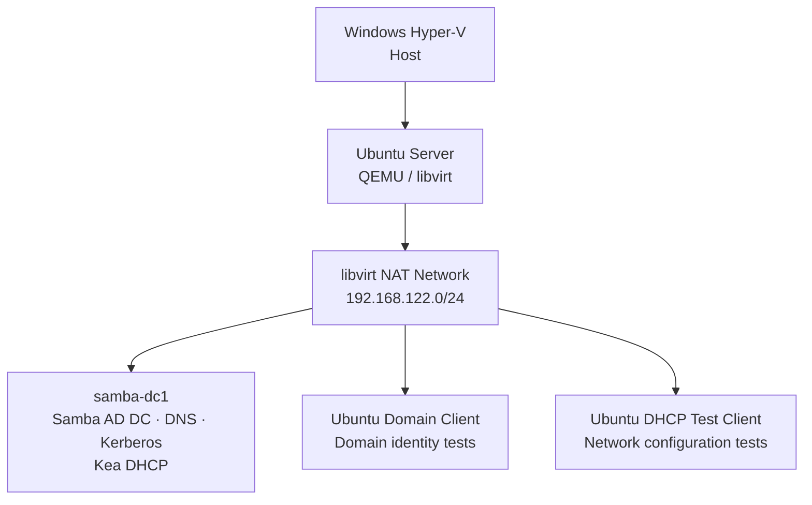

Nested virtualization was unavailable in this environment, so the QEMU guests were run using software emulation (TCG). This was noticeably slower than hardware-assisted virtualization, but it allowed me to continue the lab.

## What I Worked On

During this project, I:

- Set up Ubuntu Server and configured a virtualized Linux environment.
- Installed and provisioned a Samba AD Domain Controller.
- Created domain users and groups and tested Kerberos authentication.
- Investigated authentication logs and wrote a Bash monitoring script.
- Automated the monitoring script with Cron.
- Diagnosed and fixed a DNS forwarding problem.
- Installed Kea DHCP and investigated its interaction with libvirt networking.
- Tested domain identity resolution from an Ubuntu client.
- Performed controlled SSH and Fail2ban tests.

I completed and tested the lab exercises. The repository contains the available screenshots and written troubleshooting notes; not every original terminal output was saved.

## Project Results and Evidence

| Component | Result | Evidence |
|---|---|---|
| Virtualization | Ubuntu guests and libvirt NAT network configured | Lab documentation |
| Samba AD DC | Domain `lab.local` provisioned, users and groups created | Lab documentation |
| Kerberos | Authentication tested with `kinit` and `klist` | Lab documentation |
| DNS | Incorrect DNS forwarder identified and corrected | Phase 9 screenshots |
| Monitoring | Bash script and Cron job tested | Phase 8 screenshots |
| Kea DHCP | Running service and DHCP lease recorded | Phase 10 screenshots; DHCP responder requires confirmation |
| Domain Client | Domain user and group resolution tested | Test completed; identity-resolution observation documented |
| Fail2ban | IP ban and removal tested successfully in the lab | Test completed; original full logs not archived |

## Documentation

The repository also contains supporting documentation:

- [DHCP and libvirt Troubleshooting Runbook](docs/runbooks/kea-libvirt-dhcp.md)
- [Fail2ban SSH Test Runbook](docs/runbooks/fail2ban-ssh-test.md)
- [Evidence Register](docs/evidence-register.md)
- [Infrastructure Screenshots](Screenshots/)

The following lab journal describes my work step by step.

---

# Chronologisches Laborprotokoll

## Linux Server Administration, Identity Services & Troubleshooting

In diesem Labor habe ich eine Linux-basierte Serverumgebung aufgebaut und Schritt für Schritt erweitert.

Dabei ging es mir nicht nur darum, Dienste zu installieren. Ich wollte auch verstehen, wie die einzelnen Komponenten zusammenarbeiten, welche Probleme auftreten können und wie man Fehler systematisch eingrenzt.

Deshalb habe ich neben den Konfigurationsschritten auch die Schwierigkeiten und Lösungen dokumentiert.

## Phase 1 — Hypervisor und Laborumgebung einrichten

### Durchführung

Zuerst habe ich geprüft, ob mein Windows-Rechner die Voraussetzungen für die Virtualisierung erfüllt. Dazu gehörten CPU, Arbeitsspeicher und der Hyper-V-Status.

Anschließend habe ich einen internen virtuellen Switch mit dem Namen `LabSwitch-Internal` eingerichtet. Die Laborumgebung sollte vom Firmennetzwerk getrennt bleiben.

Danach habe ich Ubuntu Server 24.04.4 LTS heruntergeladen und die SHA256-Prüfsumme kontrolliert:

```powershell
Get-FileHash "ubuntu-24.04.4-live-server-amd64.iso" -Algorithm SHA256
```

Zum Schluss habe ich die erste virtuelle Maschine `Ubuntu-Server-Base` in Hyper-V erstellt und Ubuntu Server installiert.

### Probleme und Lösungen

**1. Hyper-V-Befehle waren blockiert**

Einige PowerShell-Befehle für Hyper-V konnten aufgrund zentraler Firmenrichtlinien nicht ausgeführt werden.

Da ich die Einstellungen nicht über PowerShell ändern konnte, habe ich die benötigten Schritte über den Hyper-V Manager durchgeführt.

**2. Ubuntu startete nicht wegen Secure Boot**

Beim ersten Start wurde Ubuntu durch die Secure-Boot-Konfiguration blockiert.

Die VM verwendete noch die Vorlage „Microsoft Windows“. Nachdem ich sie auf „Microsoft UEFI-Zertifizierungsstelle“ geändert hatte, konnte Ubuntu starten.

### Was ich gelernt habe

Bei dieser Phase habe ich verstanden, warum es sinnvoll ist, Installationsdateien vor der Verwendung mit einer Prüfsumme zu kontrollieren.

Außerdem habe ich gesehen, dass administrative Einschränkungen je nach Werkzeug unterschiedlich umgesetzt sein können. Wenn die Kommandozeile nicht verfügbar ist, kann die grafische Verwaltung in manchen Fällen eine Alternative sein.

---

## Phase 2 — Ubuntu Server installieren und libvirt einrichten

### Durchführung

Nach der Ubuntu-Installation habe ich SSH aktiviert, damit ich den Server über das Netzwerk verwalten kann.

Für den Internetzugang habe ich eine zweite virtuelle Netzwerkkarte hinzugefügt und mit dem Hyper-V Default Switch verbunden.

Danach habe ich QEMU, KVM und libvirt installiert:

```bash
sudo apt install -y qemu-kvm libvirt-daemon-system libvirt-clients bridge-utils virtinst virt-manager
```

Damit wollte ich innerhalb des Ubuntu-Servers weitere virtuelle Maschinen erstellen.

### Probleme und Lösungen

**1. Nested Virtualization war nicht verfügbar**

Die verschachtelte Virtualisierung war in meiner Umgebung durch Firmenrichtlinien eingeschränkt.

Selbst einige Prüfkommandos wie `Get-VMProcessor` waren blockiert.

Da ich die Einstellung nicht selbst ändern konnte, habe ich QEMU ohne KVM-Beschleunigung verwendet.

Die virtuellen Maschinen liefen dadurch im Software-Modus (TCG). Das war langsamer, reichte aber für die geplanten Übungen aus.

**2. libvirtd startete zunächst nicht richtig**

Beim ersten Start gab es Probleme mit `libvirtd`, weil `/dev/kvm` nicht vorhanden war.

Nach einem Neustart funktionierte der Dienst im Software-Modus:

```bash
sudo reboot
```

### Was ich gelernt habe

Ich habe gelernt, dass QEMU virtuelle Maschinen auch ohne Hardware-Beschleunigung ausführen kann. Die Leistung ist dann allerdings deutlich eingeschränkt.

Außerdem wurde mir klar, dass man nach größeren Systemänderungen prüfen sollte, ob ein Neustart erforderlich ist und ob anschließend alle benötigten Dienste korrekt laufen.

---

## Phase 3 — Erste virtuelle Maschinen und samba-dc1

### Durchführung

Für die weiteren Übungen habe ich ein Ubuntu-Cloud-Image heruntergeladen.

Das Original habe ich als unveränderte Vorlage aufbewahrt. Für jede neue VM wurde eine separate Kopie erstellt.

Zuerst habe ich eine Testmaschine namens `test-vm` gestartet. Danach habe ich den eigentlichen Server `samba-dc1` vorbereitet.

Die VM wurde mit `virt-install` angelegt:

```bash
sudo virt-install --name samba-dc1 --memory 1024 --vcpus 2 \
  --disk /var/lib/libvirt/images/samba-dc1.qcow2,format=qcow2 \
  --disk /var/lib/libvirt/images/samba-dc1-seed.iso,device=cdrom \
  --os-variant ubuntu24.04 --network network=default \
  --graphics none --console pty,target_type=serial --import
```

### Probleme und Lösungen

**1. Die Netzwerkkonfiguration wurde nicht übernommen**

Anfangs habe ich eine Festplatte kopiert, die bereits von `test-vm` verwendet worden war.

Dadurch wurden Einstellungen übernommen, die für den neuen Server nicht passten.

Ich habe das Problem gelöst, indem ich eine neue Kopie des ursprünglichen Cloud-Images erstellt habe.

**2. virsh zeigte die virtuelle Maschine nicht an**

Ein weiteres Problem war, dass `virsh` die VM nicht finden konnte.

Bei der Fehlersuche habe ich festgestellt, dass libvirt zwischen `session` und `system` unterscheidet.

Seitdem verwende ich für diese Laborumgebung:

```bash
sudo virsh --connect qemu:///system
```

### Was ich gelernt habe

Cloud-Images eignen sich gut als Grundlage für mehrere virtuelle Maschinen. Wichtig ist aber, das Original unverändert zu behalten und für neue VMs eigene Kopien anzulegen.

Außerdem habe ich verstanden, warum man bei libvirt immer prüfen muss, mit welcher Verbindung gearbeitet wird.

---

## Phase 4 — Samba Active Directory Domain Controller einrichten

### Durchführung

Nachdem der Server vorbereitet war, habe ich mit der Einrichtung des Samba Domain Controllers begonnen.

Zuerst habe ich den vollständigen Hostnamen und die Zeitsynchronisation kontrolliert:

```bash
hostname -f
timedatectl
```

Danach habe ich Samba, Kerberos und Winbind installiert.

Die neue Domäne wurde mit folgendem Befehl erstellt:

```bash
sudo samba-tool domain provision --use-rfc2307 --realm=LAB.LOCAL \
  --domain=LAB --server-role=dc --dns-backend=SAMBA_INTERNAL
```

Die Domäne heißt `lab.local`.

Als DNS-Backend verwende ich den internen DNS-Dienst von Samba.

### Probleme und Lösungen

**1. Domain Provisioning schlug fehl**

Beim ersten Versuch war bereits eine alte `smb.conf` vorhanden.

Dadurch konnte Samba die neue Domäne nicht wie erwartet einrichten.

Ich habe die alte Konfigurationsdatei umbenannt und den Provisioning-Vorgang erneut ausgeführt.

**2. DNS-Port 53 war bereits belegt**

Nach der Einrichtung konnte `samba-ad-dc` den DNS-Port 53 nicht verwenden.

Die Ursache war der lokale DNS-Stub von `systemd-resolved`.

Ich habe dessen Stub-Listener deaktiviert:

```ini
DNSStubListener=no
```

Anschließend habe ich `systemd-resolved` neu gestartet und die Samba-Konfiguration erneut geprüft.

### Was ich gelernt habe

Bei der Einrichtung eines Domain Controllers müssen mehrere Dienste zusammenarbeiten.

Schon eine vorhandene Konfigurationsdatei oder ein belegter Netzwerkport kann verhindern, dass der Dienst richtig startet.

Ich habe dabei gelernt, Fehlermeldungen genauer zu lesen und zuerst nach konkreten Ursachen zu suchen, statt sofort mehrere Einstellungen gleichzeitig zu ändern.

---

### Screenshot — Samba-Konfiguration (später dokumentiert)

Die spätere Ausgabe von `sudo testparm -s` zeigt unter anderem die Rolle `ROLE_ACTIVE_DIRECTORY_DC`, die Domain `LAB.LOCAL` und die Freigaben `sysvol`, `netlogon` sowie `hr-share`.

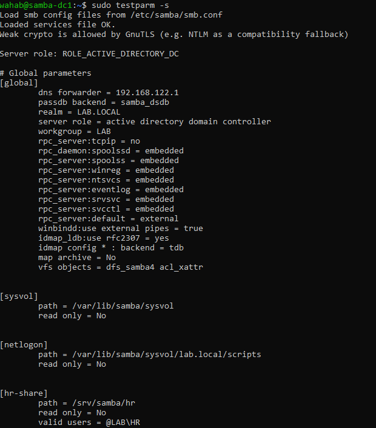

---

## Phase 5 — Domänenbenutzer, Gruppen und Kerberos

### Durchführung

Nach der Einrichtung der Domäne habe ich einen Testbenutzer und eine Gruppe erstellt.

```bash
sudo samba-tool user create wtest '<Passwort>'
sudo samba-tool group add ITAdmins
sudo samba-tool group addmembers ITAdmins wtest
```

Danach habe ich die Kerberos-Authentifizierung getestet:

```bash
kinit wtest
klist
```

Mit `kinit` habe ich versucht, ein Kerberos-Ticket für den Benutzer anzufordern.

Mit `klist` habe ich anschließend kontrolliert, ob ein Ticket vorhanden war.

### Probleme und Lösungen

**1. Sonderzeichen im Passwort verursachten einen Bash-Fehler**

Bei der Benutzererstellung gab es zunächst ein Problem mit dem Sonderzeichen `!`.

Die Bash-Shell interpretierte das Zeichen anders als erwartet.

Nachdem ich das Passwort in einfache Anführungszeichen gesetzt hatte, konnte ich den Befehl ausführen.

**2. Passwort eines Testbenutzers vergessen**

Während der Übungen hatte ich das Passwort des Benutzers `wahab` vergessen.

Über die direkte VM-Konsole konnte ich das Passwort zurücksetzen.

Dafür habe ich die Konsole über libvirt verwendet:

```bash
virsh console
```

### Was ich gelernt habe

Kerberos ist ein wichtiger Bestandteil der Authentifizierung in einer Active-Directory-Umgebung.

Ein erfolgreich ausgestelltes Ticket zeigt, dass wesentliche Teile der Kerberos-Authentifizierung funktionieren. Andere Funktionen, zum Beispiel die interaktive Anmeldung eines Linux-Clients, müssen separat überprüft werden.

Außerdem habe ich gelernt, wie wichtig der kontrollierte Zugriff auf die Serverkonsole ist.

---

## Phase 6 — Authentifizierungs-Logs untersuchen

### Durchführung

In dieser Phase wollte ich nachvollziehen, wie erfolgreiche und fehlgeschlagene Anmeldeversuche protokolliert werden.

Dafür habe ich zunächst den Samba-Log-Level in der `smb.conf` angepasst:

```ini
log level = 3
```

Anschließend habe ich `samba-ad-dc` neu gestartet und verschiedene Anmeldeversuche untersucht.

### Probleme und Lösungen

Anfangs konnte ich erfolgreiche Anmeldungen nicht wie erwartet im Standard-Log finden.

Nach der Anpassung des Log-Levels konnte ich die relevanten Protokolle genauer untersuchen.

Dabei musste ich auch zwischen Windows-Ereignisprotokollen und Samba-Logs unterscheiden.

Windows verwendet beispielsweise folgende Security Event IDs:

- `4624` — erfolgreiche Anmeldung
- `4625` — fehlgeschlagene Anmeldung

Diese IDs werden jedoch nicht automatisch in den Samba-Logs eines Ubuntu-Servers verwendet.

Deshalb habe ich für mein Monitoring die vorhandenen Samba- und Linux-Logeinträge untersucht.

### Was ich gelernt habe

Ein Logeintrag ist nur dann hilfreich, wenn man weiß, aus welchem Dienst er stammt und was er tatsächlich bedeutet.

Ich habe außerdem verstanden, wie wichtig normales Systemverhalten als Vergleichsgrundlage ist. Ohne eine solche Baseline lassen sich auffällige Ereignisse schwerer einordnen.

---

## Phase 7 — Eigenes Bash-Skript zur Überwachung

### Durchführung

Nachdem ich die Authentifizierungs-Logs untersucht hatte, wollte ich ein eigenes kleines Monitoring-Skript entwickeln.

Das Skript sollte fehlgeschlagene Anmeldeversuche zählen und bei einer erhöhten Anzahl eine Warnung ausgeben.

Für den Test habe ich mehrere fehlgeschlagene Kerberos-Anmeldungen simuliert:

```bash
for i in 1 2 3 4 5; do echo "wrongpass$i" | kinit wtest; done
```

Die Tests fanden ausschließlich in meiner eigenen Laborumgebung statt.

### Probleme und Lösungen

Bei der Auswertung zeigte das Skript mehr Logeinträge an, als ich erwartet hatte.

Statt sieben Einträgen wurden zwölf gezählt.

Bei der Untersuchung stellte ich fest, dass ein einzelner Kerberos-Anmeldeversuch mehrere interne Logereignisse erzeugen kann.

Das bedeutet, dass die Anzahl der Logeinträge nicht automatisch mit der Anzahl der tatsächlichen Anmeldeversuche übereinstimmt.

Die Warnfunktion wurde ausgelöst, aber die Zählmethode musste entsprechend vorsichtig interpretiert werden.

### Was ich gelernt habe

Mit einfachen Bash-Werkzeugen wie `grep`, Bedingungen und Schleifen kann man bereits grundlegende Monitoring-Funktionen entwickeln.

Gleichzeitig habe ich gelernt, dass die Qualität eines Monitorings nicht nur vom Skript abhängt, sondern auch davon, wie die zugrunde liegenden Logdaten interpretiert werden.

---

### Screenshot — Monitoring-Skript

Das aufgenommene Skript liest neu hinzugekommene Zeilen aus `/var/log/samba/log.samba` und zählt Treffer für `NT_STATUS_WRONG_PASSWORD`. Die Anzahl der Treffer ist nicht zwingend die Anzahl unabhängiger Anmeldeversuche.

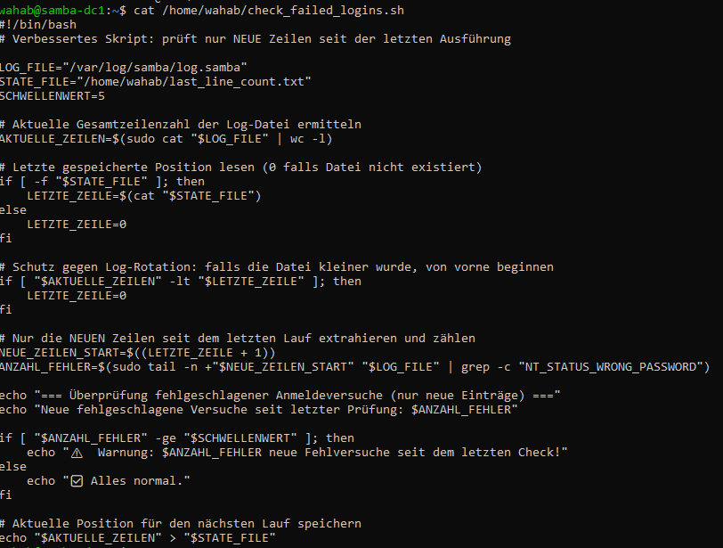

---

## Phase 8 — Monitoring mit Cron automatisieren

### Durchführung

In dieser Phase wollte ich mein Monitoring-Skript automatisch ausführen lassen.

Dafür habe ich einen Cron Job eingerichtet, der alle fünf Minuten gestartet wird:

```cron
*/5 * * * * /home/wahab/check_failed_logins.sh >> /home/wahab/monitoring.log 2>&1
```

Die Ergebnisse werden in der Datei `monitoring.log` gespeichert.

Danach habe ich das Skript erweitert.

Statt jedes Mal die komplette Logdatei auszuwerten, merkt sich das Skript die zuletzt verarbeitete Position.

Damit sollen bei einem neuen Durchlauf nur die hinzugekommenen Logeinträge berücksichtigt werden.

### Probleme und Lösungen

**1. Permission denied beim Lesen der Logdatei**

Beim Versuch, die Zeilen einer geschützten Datei zu zählen, habe ich folgenden Ansatz verwendet:

```bash
sudo wc -l < datei
```

Dabei erhielt ich einen Berechtigungsfehler.

Die Ursache war, dass die Shell die Eingabeumleitung mit den Rechten des aktuellen Benutzers ausführt, bevor `sudo` den Befehl startet.

Im Labor habe ich das Problem so gelöst:

```bash
sudo cat datei | wc -l
```

**2. Bereits bekannte Ereignisse wurden erneut gezählt**

Die ursprüngliche Version wertete bei jedem Lauf die gesamte Datei aus.

Dadurch konnten alte Ereignisse erneut in den Ergebnissen erscheinen.

Ich habe das Skript deshalb so angepasst, dass es die zuletzt gelesene Position speichert.

### Was ich gelernt habe

Automatisierung bedeutet nicht nur, einen Befehl regelmäßig auszuführen.

Man muss auch darauf achten, dass die Ergebnisse sinnvoll bleiben und bereits verarbeitete Daten nicht unnötig erneut ausgewertet werden.

Außerdem habe ich den Unterschied zwischen Shell-Umleitungen und der Rechteausführung mit `sudo` besser verstanden.

### Screenshots

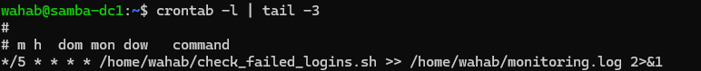

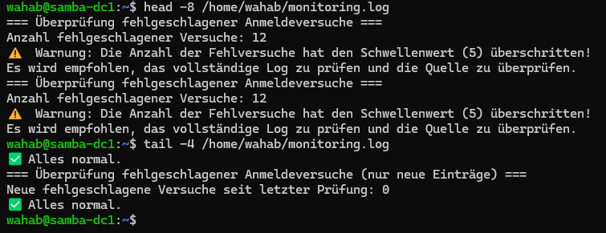

---

## Phase 9 — DNS-Probleme analysieren und Forwarder korrigieren

### Durchführung

In dieser Phase habe ich die DNS-Konfiguration meines Samba Domain Controllers genauer untersucht.

Zuerst habe ich mir die vorhandenen DNS-Zonen anzeigen lassen:

```bash
sudo samba-tool dns zonelist samba-dc1.lab.local -U Administrator
```

Anschließend habe ich die Einträge der Zone `lab.local` abgefragt:

```bash
sudo samba-tool dns query samba-dc1.lab.local lab.local @ ALL -U Administrator
```

Danach wollte ich prüfen, ob auch externe Domains aufgelöst werden können:

```bash
host google.com 127.0.0.1
```

### Probleme und Lösungen

**1. samba-tool fragte nach dem falschen Benutzer**

Beim ersten Versuch habe ich den DNS-Befehl ohne `-U Administrator` ausgeführt.

Dadurch versuchte Samba, den Benutzer `LAB\root` für die Authentifizierung zu verwenden.

Nachdem ich den Domänenadministrator ausdrücklich angegeben hatte, konnte ich die Abfrage durchführen.

**2. Externe DNS-Auflösung funktionierte nicht**

Bei der Abfrage externer Domains erhielt ich einen Timeout.

In der `smb.conf` fand ich folgende Einstellung:

```ini
dns forwarder = 127.0.0.53
```

Diese Adresse gehörte zum lokalen DNS-Stub von `systemd-resolved`.

Da ich diesen Stub zuvor deaktiviert hatte, war der konfigurierte Forwarder nicht mehr geeignet.

Ich habe daraufhin den DNS-Forwarder auf `192.168.122.1` geändert:

```bash
sudo sed -i 's/dns forwarder = 127.0.0.53/dns forwarder = 192.168.122.1/' /etc/samba/smb.conf
sudo systemctl restart samba-ad-dc
```

Danach habe ich die externe Namensauflösung erneut getestet.

Der Test war erfolgreich.

**3. Bash zeigte nur noch das Zeichen `>`**

Während der Arbeit habe ich versehentlich einen PowerShell-Befehl in die Bash-Sitzung eingefügt.

Danach erschien nur noch der Prompt `>`.

Später habe ich verstanden, dass Bash auf die Fortsetzung eines unvollständigen Befehls wartete.

Mit `Ctrl+C` konnte ich den Vorgang abbrechen.

### Was ich gelernt habe

Diese Phase hat mir besonders deutlich gezeigt, wie stark DNS von der richtigen Konfiguration der beteiligten Dienste abhängt.

Eine Einstellung, die bei der Installation noch funktioniert, kann nach einer späteren Systemänderung falsch sein.

Ich habe außerdem gelernt, einen neuen DNS-Forwarder zuerst direkt zu testen:

```bash
host google.com 192.168.122.1
```

Erst wenn dieser Test erfolgreich ist, sollte die entsprechende Konfiguration geändert werden.

### Screenshots

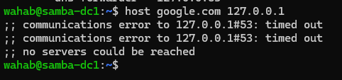

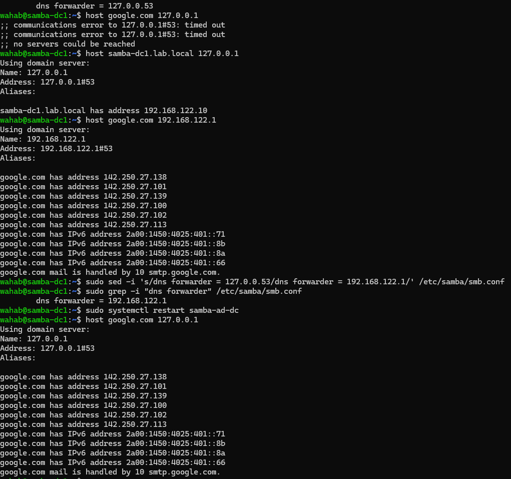

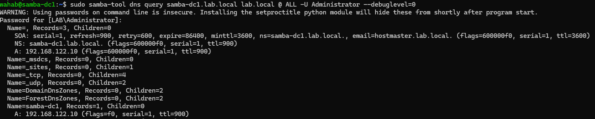

---

## Phase 10 — Kea DHCP installieren und libvirt-Netzwerk untersuchen

### Ziel

In dieser Phase wollte ich DHCP mit Kea auf meinem Ubuntu-Server einsetzen und untersuchen, wie sich der Dienst innerhalb des bestehenden libvirt-Netzwerks verhält.

Ein wichtiger Punkt war die mögliche Konkurrenz zwischen Kea DHCP und dem DHCP-Dienst von libvirt.

### Ausgangssituation

Das libvirt-Netzwerk `default` verwendet:

- NAT
- Die Bridge `virbr0`
- Das Netzwerk `192.168.122.0/24`
- Die Gateway-Adresse `192.168.122.1`

In einem älteren Screenshot der libvirt-Netzwerkkonfiguration war ein DHCP-Bereich von `192.168.122.2` bis `192.168.122.254` zu sehen.

Ein späterer Screenshot zeigte das Netzwerk ohne den entsprechenden `<dhcp>`-Block.

Das war für die Fehlersuche wichtig, weil sich die gespeicherte Konfiguration und der tatsächlich aktive Zustand eines libvirt-Netzes unterscheiden können.

### Durchführung und Beobachtungen

Auf `samba-dc1` habe ich den Kea-DHCP-Server eingerichtet.

Der Dienst `kea-dhcp4-server` wurde mit folgendem Status dokumentiert:

```text
active (running)
```

Im Journal waren außerdem folgende Informationen zu sehen:

- Netzwerkschnittstelle `enp1s0`
- Subnetz `192.168.122.0/24`
- Kea-Version `2.4.1`

In der Lease-Datei:

```text
/var/lib/kea/kea-leases4.csv
```

waren Einträge für die Adresse `192.168.122.50` vorhanden, darunter auch ein Lease für den Testclient `dhcp-test`.

Auf dem Testclient wurde folgende IPv4-Adresse angezeigt:

```text
192.168.122.50/24
```

Die Default Route verwendete:

```text
192.168.122.1
```

Auch die DNS-Konfiguration habe ich überprüft.

In `/etc/resolv.conf` stand der lokale Resolver:

```text
127.0.0.53
```

Zusätzlich wurde `lab.local` als Search-Domain angezeigt.

Dieser Eintrag zeigt allerdings nur den lokalen systemd-resolved-Stub. Welcher DNS-Server dahinter verwendet wird, muss separat überprüft werden, zum Beispiel mit:

```bash
resolvectl status
```

### Offene Frage: Welcher DHCP-Server hat geantwortet?

Die bisherigen Screenshots zeigen, dass Kea aktiv war und dass ein passender Lease dokumentiert wurde.

Sie beweisen jedoch noch nicht eindeutig, dass ausschließlich Kea die DHCP-Antwort an den Client gesendet hat.

Dafür wäre ein weiterer kontrollierter Test erforderlich.

Dabei müsste ich die aktive libvirt-Konfiguration überprüfen und den DHCP-Ablauf mit einem Paketmitschnitt nachvollziehen.

Insbesondere die DHCP-Schritte Discover, Offer, Request und Acknowledge (DORA) wären dafür relevant.

### Was ich gelernt habe

Bei DHCP reicht es nicht aus, nur zu prüfen, ob ein Client eine IP-Adresse erhalten hat.

Wichtig ist auch, welcher Server die Adresse vergeben hat.

Wenn mehrere DHCP-Server im selben Layer-2-Netz aktiv sind, kann das zu unerwartetem Verhalten führen.

Außerdem habe ich verstanden, warum man Änderungen am libvirt-Netzwerk vorsichtig durchführen sollte: Andere virtuelle Maschinen können davon ebenfalls betroffen sein.

### Dokumentation und Nachweise

Die Ergebnisse dieser Phase wurden anhand von Screenshots festgehalten.

Die vorhandenen Phase-10-Screenshots sind jetzt gemeinsam im Ordner [Screenshots](Screenshots/) abgelegt. Sie zeigen den Vergleich der libvirt-DHCP-Konfiguration, den laufenden Kea-Dienst, einen Lease-Eintrag, den Client-Test und den Monitoring-Status. Ein Paketmitschnitt zur eindeutigen Identifizierung des DHCP-Responders steht noch aus.

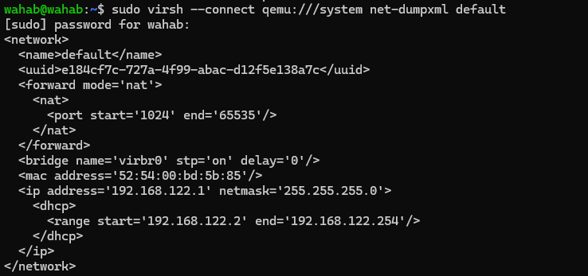

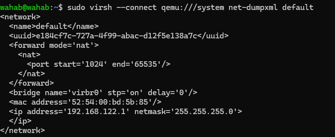

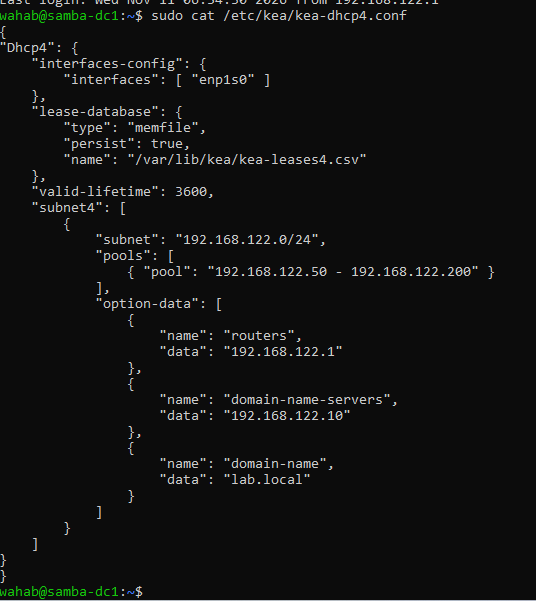

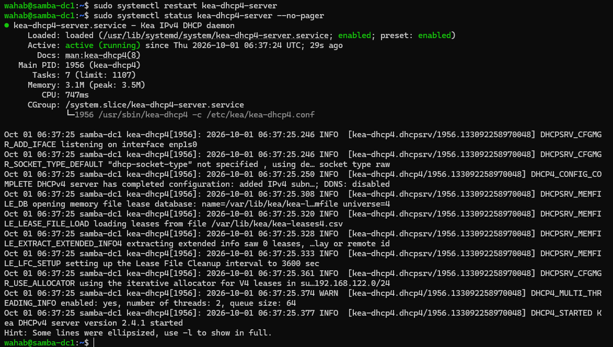

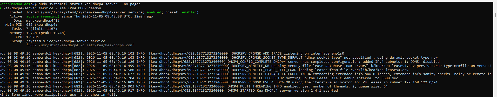

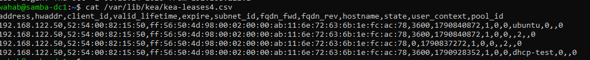

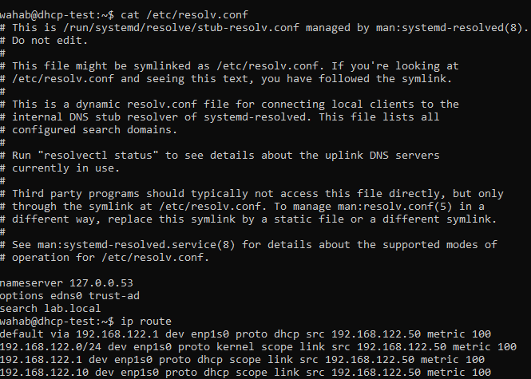

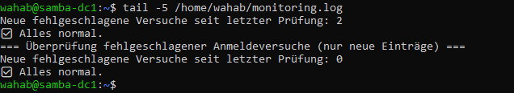

Weitere Details stehen im [DHCP-/libvirt-Runbook](docs/runbooks/kea-libvirt-dhcp.md) und im [Evidence Register](docs/evidence-register.md).

---

## Phase 11 — Ubuntu-Client in die Domäne aufnehmen

### Durchführung

Für den Linux-Client wurde die bereits vorhandene Ubuntu-VM `dhcp-test` wiederverwendet. Der Client erhielt Netzwerk- und DNS-Einstellungen per DHCP. Danach wurden `realmd`, `sssd`, `adcli` und die erforderlichen Kerberos-/PAM-Werkzeuge eingerichtet.

```bash
realm discover lab.local
sudo realm join -U Administrator lab.local
realm list
id wtest@lab.local
```

Der Domain Join war erfolgreich (`configured: kerberos-member`). Die Benutzer- und Gruppenauflösung zeigte unter anderem die Mitgliedschaft in `itadmins@lab.local`. Das automatische Anlegen von Home-Verzeichnissen wurde mit `pam-auth-update --enable mkhomedir` aktiviert. Nach erfolgreicher interaktiver Anmeldung war `/home/wtest@lab.local` verfügbar.

Für die Domain-Gruppe `ITAdmins` wurde im Lab eine eigene sudoers-Datei angelegt und mit `visudo -cf` geprüft:

```bash
echo '%itadmins@lab.local ALL=(ALL) ALL' | sudo tee /etc/sudoers.d/itadmins
sudo chmod 440 /etc/sudoers.d/itadmins
sudo visudo -cf /etc/sudoers.d/itadmins
```

Der Funktionstest `sudo whoami` ergab `root`. Diese Berechtigungsvergabe ist eine bewusste Lab-Entscheidung, keine allgemeine Empfehlung für alle Domain-Gruppen.

### Probleme und Lösungen

**SSH vom Windows-Host zum internen Client:** Die NAT-VMs im Netz `192.168.122.0/24` waren vom Host nicht direkt erreichbar. Die Verbindung erfolgte über `Ubuntu-Server-Base` (`192.168.100.10`) und von dort zum internen Ziel.

**Domain Join schlug trotz erfolgreicher Erkennung fehl:** `realm discover` funktionierte, aber `realm join` scheiterte. `kinit Administrator@LAB.LOCAL` ergab `Password incorrect`. Nach dem Zurücksetzen des Administrator-Passworts auf dem DC und erneutem Test funktionierte der Join.

**`id` erfolgreich, aber `su -` fehlgeschlagen:** Die Identitätsabfrage benötigt kein gültiges Benutzerpasswort. `kinit wtest@LAB.LOCAL` zeigte ein abgelaufenes Passwort. Nach einer zulässigen Passwortänderung gelang die Anmeldung und das Home-Verzeichnis wurde erstellt.

**`kinit` erfolgreich, aber Shell weiterhin im alten Home:** Ein Kerberos-Ticket wechselt die Linux-Sitzung nicht. Dafür war `su - wtest@lab.local` erforderlich.

### Was ich gelernt habe

DNS, Kerberos, Domain-Mitgliedschaft, SSSD, PAM, Home-Verzeichnis und sudo sind getrennte Ebenen. Die erfolgreiche Identitätsauflösung ist nicht dasselbe wie ein interaktiver Login; beides wurde in diesem Lab separat untersucht.

---

## Phase 12 — HR-Freigabe und fünf Troubleshooting-Runbooks

### Durchführung

Auf `samba-dc1` wurden die Gruppe `HR`, ein Testbenutzer `hruser` und die Samba-Freigabe `hr-share` eingerichtet:

```bash
sudo samba-tool group add HR
sudo samba-tool user create hruser
sudo samba-tool group addmembers HR hruser
sudo mkdir -p /srv/samba/hr
sudo chmod 0777 /srv/samba/hr
```

Die Freigabe verwendete `path = /srv/samba/hr`, `read only = no` und eine `valid users`-Beschränkung auf `LAB\HR`. Das Samba-Setup wurde mit `testparm -s` geprüft; der Zugriff wurde auf dem Ubuntu-Client mit CIFS getestet.

**Sicherheitshinweis:** `chmod 0777` wurde im Test bewusst permissiv gesetzt, um die gruppenbasierte Samba-Zugriffskontrolle zu isolieren. Es wäre keine geeignete Standardberechtigung für einen produktiven Share; dort wären restriktive POSIX-/ACL-Rechte erforderlich.

### Probleme, Diagnose und Lösungen

1. **Permission denied bei `hr-share`:** `wtest` fehlte in der Domain-Gruppe `HR`. Nach `samba-tool group addmembers HR wtest` funktionierte der Zugriff.
2. **Anmeldung mit deaktiviertem Konto:** `kinit` meldete `Client's credentials have been revoked`, und `userAccountControl` war `514`. Nach `samba-tool user enable wtest` war das Konto wieder aktiv (`512`); bei Bedarf wurde der SSSD-Cache berücksichtigt.
3. **Clock-Skew-Versuch:** Die Client-Zeit wurde um zehn Minuten verändert, aber `kinit` funktionierte weiterhin. **Der erwartete Kerberos-Fehler trat nicht ein.** Die Zeit wurde wieder synchronisiert. Eine automatische Kompensation wurde als mögliche Erklärung diskutiert, aber nicht nachgewiesen.
4. **DNS-Fehler:** Ein absichtlich falscher Resolver (`192.168.122.99`) verursachte `SERVFAIL`. Mit `resolvectl status` wurde der Fehler erkannt und mit `sudo resolvectl revert enp1s0` behoben.
5. **Client nicht mehr Mitglied der Domäne:** Nach `realm leave` war `realm list` leer und `id wtest@lab.local` konnte den Benutzer nicht mehr auflösen. Ein erneutes `realm join -U Administrator lab.local` stellte die Domain-Mitgliedschaft wieder her.

Eine weitere Werkzeugverwechslung wurde ebenfalls dokumentiert: `samba-tool`-Aufrufe zur lokalen Domain-Datenbank schlugen auf dem Client mit fehlender `sam.ldb` fehl. Diese administrativen Befehle gehören in dieser Übung auf den DC.

**Runbooks:** [HR-Freigabe und Client-Troubleshooting](docs/runbooks/domain-client-and-hr-share.md).

### Was ich gelernt habe

Ein Runbook trennt Symptom, Ursache, Diagnose, Lösung und Vorbeugung. Ein Test, der den erwarteten Fehler **nicht** auslöst, wird genau so festgehalten und nicht als erfolgreicher Fehler-Fix ausgegeben.

---

## Phase 13 — SSH-Schutz mit Fail2ban und Ressourcenprüfung

### Durchführung

Fail2ban wurde auf dem Ubuntu-Client eingerichtet. Die dokumentierten Lab-Einstellungen für die `sshd`-Jail waren:

```ini
[sshd]
enabled = true
backend = systemd
maxretry = 3
findtime = 10m
bantime = 120
```

Der Testverkehr kam von `samba-dc1` (`192.168.122.10`) und zielte auf den Client (`192.168.122.50`). Nach fehlgeschlagenen SSH-Anmeldungen meldete `fail2ban-client status sshd`:

```text
Currently banned: 1
Banned IP list: 192.168.122.10
```

Eine SSH-Verbindung von `Ubuntu-Server-Base` über eine andere Quelladresse funktionierte weiter. Die Sperre wurde mit `fail2ban-client set sshd unbanip 192.168.122.10` aufgehoben; die Ausgabe war `1`.

### Probleme und Einordnung

Nach zwei sichtbaren `Permission denied`-Antworten folgte `Connection refused`. Obwohl `maxretry = 3` gesetzt war, lässt sich die Zahl der intern gezählten Authentifizierungsfehler aus der Anzahl der sichtbaren SSH-Ausgaben nicht zuverlässig ableiten. Der Ban ist über den Jail-Status dokumentiert; `Connection refused` allein wäre kein ausreichender Ursachenbeweis.

Ein zuvor falsch eingegebenes Administrationspasswort hatte bereits einen Fehlversuch von der Verwaltungsmaschine erzeugt. Ein Test-Ban kann deshalb auch die eigene Verwaltungsadresse treffen.

Zusätzlich wurden die Ressourcen mit `uptime`, `free -h`, `df -h` und `ss -tulnp` überprüft. Die Lernnotizen nennen für den Client etwa 709 MiB RAM insgesamt, 393 MiB verfügbar und 60 % Belegung des Root-Dateisystems zum Messzeitpunkt.

### Was ich gelernt habe

Im Gegensatz zum selbst geschriebenen Monitoring-Skript kann Fail2ban nach einem Log-Ereignis eine automatisierte Gegenmaßnahme auslösen. Die Konfiguration und das Verhalten gehören immer zu einem bestimmten Testzeitpunkt; sie sind keine universelle Produktionsvorlage.

**Runbook:** [Fail2ban SSH-Test](docs/runbooks/fail2ban-ssh-test.md).

---

# Lessons Learned

Dieses Projekt war für mich vor allem eine praktische Übung im systematischen Troubleshooting.

Ich habe festgestellt, dass viele Probleme nicht durch die Installation selbst entstehen, sondern durch das Zusammenspiel verschiedener Dienste und Konfigurationen.

Besonders hilfreich waren für mich folgende Erfahrungen:

**1. Fehlermeldungen genauer untersuchen**

Bevor ich eine Konfiguration ändere, versuche ich inzwischen besser zu verstehen, was die Fehlermeldung tatsächlich aussagt.

**2. Abhängigkeiten zwischen Diensten erkennen**

Das DNS-Problem mit Samba und `systemd-resolved` hat mir gezeigt, dass eine Änderung an einem Dienst auch Auswirkungen auf andere Komponenten haben kann.

**3. Änderungen einzeln durchführen und testen**

Gerade bei Netzwerkkonfigurationen ist es wichtig, den Ausgangszustand zu kennen und Änderungen nachvollziehbar zu dokumentieren.

**4. Monitoring-Ergebnisse richtig interpretieren**

Mehrere Logeinträge bedeuten nicht automatisch mehrere unabhängige Anmeldeversuche.

**5. Ergebnisse mit Nachweisen dokumentieren**

Ein laufender Dienst ist nicht automatisch der Beweis dafür, dass eine bestimmte Funktion vollständig und korrekt arbeitet.

Deshalb möchte ich bei zukünftigen Übungen noch stärker mit Baselines, Screenshots, Logs und gezielten Funktionstests arbeiten.

---

# Project Scope and Limitations

This repository documents a controlled educational lab.

It should not be interpreted as a production deployment, security audit, or certification of the configured services.

The main limitations are:

- The physical virtualization host uses Windows Hyper-V, while the server and client lab systems run Ubuntu.
- Nested KVM acceleration was unavailable, so QEMU software emulation was used.
- Samba AD DC provides important Active Directory-compatible capabilities but does not reproduce every feature of Microsoft AD DS.
- A successful Kerberos ticket does not by itself verify every domain login function.
- The documented DHCP lease does not conclusively identify the responding DHCP server.
- Some original domain-client and Fail2ban terminal outputs were not archived, although the lab tests were completed.

Passwords, Kerberos tickets, SSH keys, sensitive authentication logs, and real client data should never be committed to the repository.

## Next Steps

For future documentation improvements, I plan to organize any remaining available evidence for the completed lab tests.

Optional future deep-dive exercises include packet-level DHCP analysis and more detailed authentication evidence. These are extensions, not prerequisites for describing the completed lab work.

I also want to continue improving the documentation so that each phase clearly shows the initial state, the implementation, the problem, the troubleshooting process, and the final verification.

---

## Final Note

This project represents my practical learning process in Linux server administration.

Not every configuration worked on the first attempt, and some tests still need additional verification. Documenting those limitations is part of the project.

The most valuable experience for me was learning how to investigate problems, understand service dependencies, test possible solutions, and explain what the available evidence actually shows.
